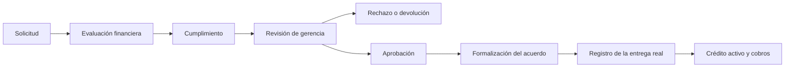

# Integración local y navegación por roles

Implementación aprobada el 9 de octubre de 2026. El código anterior a esta fase
está copiado en `.review/integration-before/`. No se alteró la base real para probar.

## Navegación

| Rol | Destinos | Acción principal |
|---|---|---|
| Solicitante | Inicio, Mis solicitudes, Perfil | Solicitar préstamo en tres pasos |
| Analista | Inicio, Bandeja, Perfil | Evaluar con las reglas existentes y decidir su etapa |
| Cumplimiento | Inicio, Bandeja, Perfil | Revisar y decidir su etapa |
| Gerencia | Inicio, Solicitudes, Cartera, Perfil | Revisar pendientes, formalizar y registrar entregas |

Cartera conserva Clientes, Cobros e Informes. Ajustes del negocio y herramientas
avanzadas están en Perfil. Los créditos activados se abren desde la cartera,
el cliente o los cobros previstos; el expediente enruta el cobro a `CreditService`.
Los comprobantes y operaciones originales mantienen su recorrido y motor.

El sistema visual usa la identidad morada, superficies claras, ancho de lectura
limitado y navegación lateral en Windows. Las respuestas al pulsar y transiciones
usan los componentes compartidos y respetan reducción de movimiento. La pantalla
de solicitud muestra condiciones, cuotas y todos los costos antes de enviarse.
No se cambiaron el umbral DTI ni los permisos de evaluación.

## Ciclo financiero

Aprobar conserva una cotización y no genera deuda cobrable. Formalizar exige
cliente existente verificado y referencia del acuerdo; tampoco mueve caja.
Registrar el desembolso exige fecha efectiva, referencia y confirmación de entrega.
La referencia es única y la activación es idempotente: repetir exactamente la
misma operación no crea otra entrega. Se valida el capital dentro de la misma
transacción que escribe el crédito y la bitácora.

`credit_accounts` guarda el vínculo único con `applicationId`, condiciones,
versión, evidencia y plan activo. No se copia el crédito a `loans`. `CreditEngine`
genera sus cuotas desde la fecha de entrega; `LoanCalculator` conserva las reglas
de los préstamos directos. No hay transferencia bancaria: se registra una entrega
que el administrador confirma que ya ocurrió.

La caja común se calcula como aportes menos entregas directas más sus cobros,
menos entregas de créditos activados más sus cobros vigentes, ajustados por el
saldo de apertura conciliado. No se crea un retiro duplicado en `capital_history`.
Una aprobación o formalización queda fuera de esta suma. Los pagos anulados
permanecen en el historial y dejan de aportar caja. La validación de capital
también impide crear un préstamo directo utilizando dinero ya desembolsado.

Los informes distinguen capital pendiente, interés cobrado y saldo contractual.
Este último incluye cuotas futuras y costos pactados; no es ganancia realizada.
CSV y PDF incorporan ambos tipos de préstamo. Los gráficos y el cierre diario
incluyen sus cobros activos. Los desembolsos nuevos se cuentan una sola vez.

## Expedientes anteriores

No se presume que una aprobación antigua represente una entrega. Sus planes y
pagos se conservan exactamente y se identifican como pendientes de conciliación.
Gerencia debe verificar cliente, fecha real, evidencia y tratamiento de caja.

Si esos movimientos ya forman parte del disponible original, se conserva un
saldo de apertura fijo de cobros anteriores y no se resta otra entrega. Los
cobros nuevos aumentan el disponible y anular un cobro anterior lo reduce.
Si todavía no están incluidos, la conciliación incorpora la entrega y sus
cobros. El administrador debe verificar que el mismo contrato no esté registrado
como préstamo directo; no existe identificación automática fiable entre ambos
modelos históricos. La operación solo se admite una vez por solicitud.

## Persistencia y recuperación

El esquema es aditivo dentro de `business_v2` en Hive. Las escrituras están
serializadas y guardan cambio y bitácora juntos. La interfaz escucha eventos
locales de modificación para actualizar la cartera; las consultas de pantalla
no cargan la bitácora completa en cada lectura.

El respaldo completo v3 incluye clientes, préstamos directos, solicitudes,
créditos vinculados, planes, pagos, capital y reglas. Su restauración verifica
identidades, vínculos únicos, condiciones, fechas, planes y apertura conciliada
antes de escribir. Se conserva la compatibilidad con respaldos completos v2 y
la importación original v1. Las cuentas propietarias deben existir con sus IDs;
el archivo no incluye contraseñas, sesiones ni secretos TOTP.

Restaurar un respaldo completo reemplaza el negocio únicamente después de la
confirmación explícita del usuario. Reiniciar solo la cartera original se
bloquea cuando tiene créditos vinculados, para no dejar clientes huérfanos.
No se ejecutó ninguna restauración, reinicio ni conciliación sobre datos reales.

## Alcance de la sincronización

Funciona entre cuentas de la misma instalación. Hive y los eventos locales no
comparten solicitudes entre dispositivos. Falta seleccionar o proporcionar API,
autenticación central y almacenamiento del servidor. La arquitectura propuesta
en `propuesta-premium-ui-integracion.md` sigue pendiente de esa configuración:
permisos en servidor, claves únicas, control de versiones, reintentos y pruebas
con dos dispositivos. No se añadió un estado ficticio de sincronización.

## Validación

Las pruebas usan bases temporales y cubren solicitud por pasos, permisos,
aprobación confirmada, formalización, entrega, capital insuficiente, repetición
concurrente, cobros y anulaciones, conciliación anterior, restauración inválida,
persistencia, métricas y cierre. La revisión visual incluye móvil y Windows,
texto ampliado y reducción de movimiento.

Las capturas de `.review/ui-*.png` proceden de widgets Flutter con datos de prueba.
Comprobación del 9 de octubre de 2026: `flutter analyze` sin advertencias y
`flutter test` con 59 pruebas aprobadas; `flutter build windows` completado.
Los hashes de `LoanCalculator`,
`CreditEngine` y `LoanTransaction` coinciden con la copia anterior a esta fase.
Los plugins de compartir, biometría y notificaciones requieren comprobación en
su dispositivo compatible. Las pruebas de widgets no miden FPS; no se ha medido
el rendimiento en un teléfono de gama media ni la sincronización remota.
