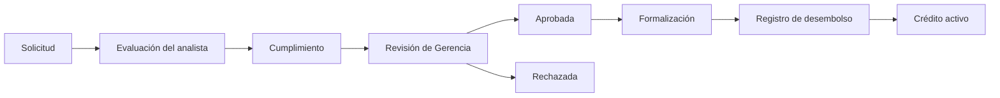
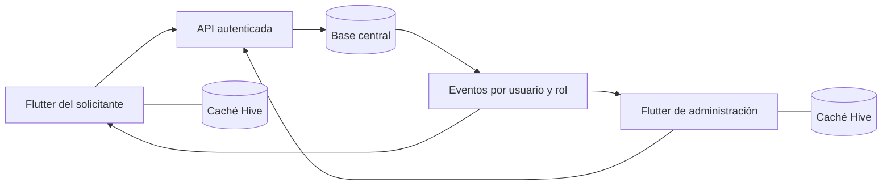

# Contador Engine: propuesta de interfaz e integración

Fecha: 9 de octubre de 2026. Esta propuesta fue aprobada para implementación.
Describe la auditoría y la muestra previas al cambio. El estado del código
implementado se documenta en [Integración local y navegación por roles](integracion-local-creditos.md).
La muestra HTML utiliza datos ficticios y no ejecuta operaciones; las capturas
`ui-*.png` corresponden a la nueva interfaz Flutter con datos de prueba.

## 1. Referencias revisadas

Se leyó completamente `docs/contexto-para-chatgpt.md` y se contrastó con el código.

### Pinterest

Referencia del usuario: https://pin.it/3aN1AdH2I.
El enlace resolvió al pin `68257750599200772`; su contenido compartido identifica
un diseño de seguimiento de entrenamiento. La imagen descargada está en
`.review/pinterest-ui-reference.jpg`.

La imagen muestra una tarjeta protagonista, título grande, estado discreto,
acción horizontal dominante, pequeñas cifras de apoyo, superficies claras con
esquinas amplias y navegación flotante de tres destinos. Tiene varias tarjetas
de gráficos: se toma su jerarquía, pero la cantidad de indicadores se reduce
para este negocio. Es una imagen estática; no demuestra animaciones ni transiciones.

Aplicación a Contador Engine: destacar una solicitud o tarea pendiente, usar
una acción principal por pantalla, listas con separadores suaves, cifras
tabulares y navegación compacta con etiquetas. Se preserva la identidad morada.

### Video local

Se revisó la secuencia existente en `.review/video/contact-sheet.png` y los
fotogramas del MOV de 19 segundos: bienvenida construida por etapas, paso gradual
al acceso y aparición progresiva del inicio. La captura cada 500 ms permite
observar continuidad, pero no medir con precisión las curvas ni el rendimiento.

Se propone mantener una bienvenida de 650–800 ms, respuesta al pulsar de
160–200 ms, paneles de 220 ms y cambios de pantalla/pasos de 280–360 ms.
Son duraciones propuestas para esta app, no mediciones extraídas del video.

## 2. Auditoría del funcionamiento real

| Área | Qué existe | Qué falta o requiere cuidado |
|---|---|---|
| Inicio y roles | `main.dart` dirige Gerencia a `HomeScreen` y otros roles a `CreditPortalScreen` | Gerencia no tiene una entrada a Solicitudes desde su inicio actual |
| Cartera original | Clientes, préstamos directos, cobros, capital, vencimientos, gráficos y comprobantes | No incluye automáticamente solicitudes ni pagos del segundo módulo |
| Solicitudes | Borrador, envío, evaluación por analista, cumplimiento y decisión de gerencia | Formulario largo en diálogo, jerarquía similar entre roles y acciones del expediente con peso visual parecido |
| Permisos | Validados en servicios; solicitantes solo leen sus expedientes | La nueva navegación debe conservarlos: Gerencia no tiene permiso de evaluar como analista |
| Aprobación | Cambia estado a `approved` y genera `schedule` desde la fecha de aprobación | No hay formalización, desembolso ni activación explícitos |
| Cobros del módulo | Gerencia puede cobrar una solicitud `approved` | Aprobación equivale operativamente a crédito cobrable en este módulo; debe corregirse en la fase financiera aprobada |
| Capital | `DebtProvider` utiliza préstamos y cobros originales | Una aprobación no reduce su disponible ni entra en el cierre diario |
| Datos | Hive, cuentas locales, sesiones, caché y preferencias | No existe servidor de solicitudes ni sincronización entre dispositivos |
| Respaldo | Original v1 y respaldo de negocio v2; v2 incluye ambos módulos | Restaurar v2 necesita las cuentas propietarias correspondientes; no migra cuentas entre dispositivos |
| Seguridad | Hash de contraseña, TOTP y bloqueo adicional por PIN/biometría | Son controles locales; no constituyen autorización remota ni cifrado del negocio en reposo |

El comentario sobre sincronización en `LocalCacheService` describe una intención
previa. En el código actual `DebtProvider.isOffline` devuelve `false` y
`_writeOrQueue` llama directamente a la base local. La cola no es un cliente de
sincronización operativo.

Las pruebas del portal gerencial construyen esa pantalla directamente; no
demuestran que Gerencia pueda alcanzarla desde `main.dart`.

## 3. Navegación y pantallas propuestas

Una estructura de aplicación compartida, con destinos y acciones según el rol.
La navegación preserva búsqueda, filtros y posición al cambiar de pestaña.
Barra inferior compacta con texto en móvil; barra lateral desde 900 px en Windows.
Formularios limitados a 640–720 px; el escritorio aprovecha una segunda columna
para resumen o expediente, sin estirar campos de lado a lado.

### Solicitante: Inicio / Mis solicitudes / Perfil

- **Inicio:** saludo breve, última solicitud por fecha, estado y siguiente paso;
  botón «Solicitar préstamo». Si no hay solicitudes, una explicación corta y
  esa misma acción. Sin estadísticas administrativas.
- **Mis solicitudes:** lista propia, monto, fecha y estado; filtro secundario.
  Abrir expediente muestra condiciones, progreso, motivos de devolución o
  rechazo y el siguiente paso. No muestra expedientes ajenos.
- **Perfil:** nombre y correo existentes, contraseña, TOTP, bloqueo compatible
  con el dispositivo y cierre de sesión. Los datos de perfil que aún no admite
  el modelo no se presentan como campos guardables.
- **Solicitud en tres pasos:** 1) monto, destino, plazo y modalidad;
  2) ingresos, gastos y cuotas de otras deudas; 3) revisión completa.
  El último paso muestra tasa nominal anual, modalidad, cuota máxima estimada,
  total estimado, interés, seguro, comisión y mora, incluso cuando sean cero.
  Se explican cuotas francesa/alemana y la política actual de anticipos.
  «Ver condiciones» permanece accesible desde los pasos anteriores.
- **Edición de condiciones:** la app actual permite introducir tasa y cargos.
  Durante el rediseño se conservan mediante una sección secundaria visible y
  explicada; no se convierte silenciosamente a un catálogo de productos del
  negocio. Definir condiciones exclusivamente por administración sería otra
  modificación funcional que requiere diseño y autorización.
- **Envío:** primero validar y guardar un borrador con su identificador; después
  enviar ese mismo registro con `CreditService.submit`. Si falla el envío,
  conservar el borrador y permitir reintentar sin crear otro registro.
  Confirmar «Solicitud enviada» solo después de persistir el estado correcto.

### Administrador: Inicio / Solicitudes / Cartera / Perfil

- **Inicio:** una superficie principal con pendientes de decisión de Gerencia
  y botón «Revisar solicitudes». Mostrar también solicitudes recientes de otras
  etapas, con su estado. Una franja financiera de apoyo y acceso «Cobros de hoy»;
  el disponible se identifica como correspondiente a la cartera original hasta
  que haya conciliación financiera. Sin suma prematura de ambos módulos.
- **Solicitudes:** listas «Para decidir», «En revisión», «Aprobadas» y «Todas»;
  orden por fecha y búsqueda. Estado y responsable de etapa siempre visibles.
  El filtro por defecto evita tratar todo el proceso como una sola bandeja.
- **Expediente:** monto y plazo primero; condiciones y perfil financiero;
  DTI, cuota utilizada, disponible tras cuota, puntaje, regla y versión; historial
  de decisiones. La recomendación no sustituye la decisión humana.
  Distinguir «Aprobar solicitud» de «Aprobar etapa». Rechazo tiene tratamiento
  de peligro, devolución es secundaria; cada decisión confirma expediente,
  consecuencias y motivo obligatorio. Solo se habilitan las acciones permitidas.
- **Cartera:** preservar clientes, préstamos directos, cobros, informes y capital
  originales. Accesos secundarios «Clientes», «Cobros» e «Informes», con
  cierre diario y exportación dentro de Informes, y movimientos dentro de Capital.
  Los créditos del módulo permanecen identificados por origen y estado;
  las aprobaciones pendientes de desembolso pertenecen a Solicitudes.
  Los registros históricos sin evidencia de desembolso se muestran como créditos
  del módulo anterior pendientes de conciliación, sin reasignarles estado real.
- **Perfil:** cuenta y seguridad, seguido de ajustes del negocio agrupados:
  capital, cobros, respaldo, actualizaciones y parámetros avanzados.
  Bitácora y configuración DTI quedan accesibles en administración avanzada.

### Analista y Cumplimiento

Inicio / Bandeja / Perfil. El analista ve su etapa y puede evaluar con las reglas
existentes; Cumplimiento ve su revisión y las decisiones permitidas. No reciben
la cartera ni herramientas financieras gerenciales. Gerencia puede consultar el
análisis, pero no ejecutar acciones de analista por un cambio de interfaz.

## 4. Sistema visual y movimiento

- Logo existente; lavanda luminoso `#B976FF`, morado intenso `#8D45E8`, fondo
  `#FAF9FC`, superficies blancas, texto `#191620` y lavanda `#F4ECFF`.
  Para texto pequeño sobre blanco se mantiene un tono más oscuro cuando lo
  necesite el contraste; el acento claro funciona con texto oscuro.
- Roboto local, títulos con peso y espacio, importes con cifras tabulares,
  bordes de 16–24 px, controles de al menos 48 px, sombras suaves y limitadas.
- Un bloque protagonista; los datos relacionados se muestran en filas en vez
  de una tarjeta por dato. Estados con texto e icono, además del color.
- Componentes previstos: `RoleShell`, `RequestSummary`, `RequestListRow`,
  `ApplicationStepper`, `TermsSummary`, `EvaluationSummary`, `DecisionSheet`,
  `PortfolioListRow` y `AdvancedSettingsGroup`.
- Reutilizar `AppMotion`, `PageFrame`, `Reveal`, `TabContent` y el tema existentes.
  `AnimatedSwitcher` en los pasos, tamaño animado sin saltos, entrada escalonada
  solo en los primeros bloques visibles y continuidad entre fila y expediente.
- `disableAnimations`, lectura con tecnologías de asistencia, foco de teclado,
  texto ampliado y contenido desplazable. Deshabilitar animaciones continuas
  en pantallas ocultas. Evitar desenfoques de fondo y cascadas en listas largas.

Guía de contraste y accesibilidad:
[documentación oficial de Flutter](https://docs.flutter.dev/ui/accessibility).

## 5. Los ocho puntos de integración financiera

| Pregunta | Cartera original | Módulo de solicitudes |
|---|---|---|
| 1. Representación | `LoanTransaction`, cliente por `customerId`, saldo derivado | Map de solicitud: `ownerId`, `terms`, `profile`, `evaluation`, decisiones y `schedule` |
| 2. Motor | `LoanCalculator`, coordinado por `DebtProvider` | `CreditEngine` y `ScoringRules`, coordinados por `CreditService` |
| 3. Pagos | `Payment`, monto decimal y `loanId`; interés antes que capital; edición/eliminación con bitácora | Centavos y `applicationId`; referencia activa única por solicitud; anulación conserva el registro |
| 4. Amortización | Interés periódico porcentual sobre saldo o monto fijo, cuatro frecuencias y política por préstamo | Francés o Alemán mensual; cargos separados; ajuste de centavos en última cuota; anticipos sin recalcular intereses |
| 5. Almacenamiento | Listas `customers`, `loans`, `payments`, `capital_history` | Listas `applications`, `credit_payments`, reglas `scoring_rules`; plan dentro de solicitud |
| 6. Al aprobar | No recibe un nuevo préstamo ni movimiento de capital | Se crea el plan desde `approvedAt`; se incluye en resumen y se habilita cobro |
| 7. Conversión | No existe enlace a una solicitud aprobada | No hay proceso de formalización/desembolso ni enlace a `LoanTransaction` |
| 8. Duplicados | Se impiden identificadores repetidos, pero un préstamo nuevo recibe otro UUID | Impide repetir decisión fuera de etapa y referencias de pago; falta una clave única solicitud–crédito activado |

Ambos grupos de datos viven en `business_v2` de la misma caja Hive, no en una
base compartida entre equipos. Cambiar el nombre de una pantalla o copiar el
monto a `LoanTransaction` no preserva la amortización ni evita doble registro.

## 6. Estrategia recomendada: unir acceso, preservar contratos

### Etapa A: presentación sobre los servicios actuales

Reorganizar las pantallas y exponer el portal gerencial dentro de Solicitudes.
Crear un estado observable de solicitudes para refrescar después de las
operaciones locales; conservar `DebtProvider` para la cartera original.
No modificar motores, etapas ni permisos. No copiar solicitudes a `loans`.
Identificar correctamente el alcance de las cifras existentes.

### Etapa B: ciclo de vida financiero, sujeto a aprobación

Mantener el proceso de decisión existente:

Rechazo o devolución también pueden ocurrir en las etapas autorizadas actuales.
La aprobación conserva una propuesta de condiciones; no altera disponible ni
genera mora cobrable. Un ciclo separado de formalización registra aceptación,
versión de condiciones y, cuando corresponda, evidencia del acuerdo. Desembolsar
registra monto, fecha efectiva, referencia y actor. Es un registro de una entrega
real realizada por el negocio, no una transferencia bancaria hecha por la app.

Crear un registro de crédito amortizado vinculado a la solicitud, con identidad
estable y condiciones congeladas, sin transformarlo en préstamo periódico
original. Activarlo una sola vez genera el plan vigente desde la fecha efectiva
de desembolso y guarda el movimiento de salida con su bitácora. Cobros posteriores
se asignan a ese crédito y usan `CreditEngine`. Mantener una relación verificada
entre la cuenta solicitante y el cliente del negocio, sin unirlos solo por nombre.

La vista de cartera utiliza adaptadores de lectura para los dos tipos de
contrato. Cada fila incluye origen y motor. Los cobros se enrutan al servicio
correspondiente. Solo créditos activos y préstamos directos participan en
totales conciliados. Separar capital, interés y cargos; no sumar saldos de planes
futuros como si fueran capital prestado o ganancia cobrada.

Para el disponible, construir una única proyección de movimientos: aportes y
retiros, entregas efectivas y entradas de cobro, con referencias estables a cada
operación. Respetar primero la política original de reinversión de ganancias;
no añadir un retiro en `capital_history` y descontar además el mismo desembolso
por otro cálculo. Conciliar esta proyección con el saldo anterior antes de
mostrar un disponible conjunto.

### Evitar duplicados

- Restricción única sobre solicitud y crédito activado, dentro del negocio.
- Clave de operación estable para reintentos de envío, desembolso y cobro.
- Validación de estado y versión de registro, transacción y bitácora juntas.
- El servidor decide las transiciones; deshabilitar un botón no basta.
- No crear copia del mismo crédito en `loans` y en otra tabla para luego sumar ambas.

Una base SQL puede garantizar claves únicas y relaciones:
[restricciones de PostgreSQL](https://www.postgresql.org/docs/current/ddl-constraints.html).

### Datos ya aprobados

No se presume que `approvedAt` sea una fecha de desembolso. Los planes y pagos
actuales se conservan como registros anteriores del módulo, con marca de origen.
Se requiere conciliación explícita del negocio para clasificarlos y enlazarlos.
No regenerar planes pagados, mover cobros ni reiniciar saldos automáticamente.
También deberá actualizarse el formato de respaldo: su validador actual exige
que el plan aprobado coincida con la fecha de aprobación.

## 7. Sincronización real propuesta

**Hoy:** solicitante y administrador pueden trabajar sobre las mismas solicitudes
al cambiar de cuenta en una misma instalación. Dos teléfonos o un teléfono y
Windows tienen bases y cuentas independientes; no comparten solicitudes.

**Propuesta:** Flutter + repositorios de datos + Hive como caché local + API
autenticada + base central transaccional, por ejemplo PostgreSQL. El proveedor
concreto de alojamiento/autenticación queda por seleccionar antes de desplegar.

- Usuarios globales, pertenencia al negocio, roles asignados por administración,
  TLS y credenciales de sesión protegidas en el dispositivo.
- Permisos y reglas de negocio en el servidor. Solicitante solo accede a lo
  propio; analista/cumplimiento a lo autorizado; Gerencia al negocio. Políticas
  de filas pueden reforzar el aislamiento:
  [seguridad por filas de PostgreSQL](https://www.postgresql.org/docs/current/ddl-rowsecurity.html).
- Reutilizar el motor Dart en el backend si la tecnología lo permite; si se
  implementa en otro lenguaje, exigir las mismas pruebas de referencia de
  cuotas, redondeo y DTI. La evaluación oficial se calcula y versiona en servidor.
- Eventos/WebSocket para avisar cambios y consultas autenticadas para obtener
  el estado; cursor/versiones y recuperación tras desconexión, no confiar solo
  en recibir todos los eventos en tiempo real.
- Borradores locales pueden editarse sin conexión. Envíos pendientes se muestran
  como pendientes hasta recibir confirmación. Aprobaciones, desembolsos y cobros
  requieren confirmación del servidor en la primera versión sincronizada.
- Conflictos financieros se rechazan para revisión; no usar «último cambio gana»
  para pagos, condiciones o decisiones. Referencias anuladas permanecen auditables.
- No subir hashes, sesiones ni secretos TOTP locales como mecanismo de alta.
  Vincular o invitar cuentas y conservar una tabla explícita de identidades.
- Importación inicial controlada: respaldo, validación, vista previa de diferencias,
  negocio propietario, IDs de origen, conciliación y copia local conservada.
  Un importador del negocio migra datos; restaurar una copia no debe reemplazar
  una base central compartida por todos los usuarios.

Esta propuesta no promete sincronización hasta que existan servidor, permisos
y pruebas con al menos dos dispositivos reales.

## 8. Cobertura de pantallas y simplificación

| Pantalla actual | Ubicación propuesta y cambio |
|---|---|
| Auth / Lock | Acceso sencillo con marca; seguridad y recuperación existentes |
| HomeScreen | Estructura por rol; cartera original conservada como contenido reutilizable |
| CreditPortalScreen | Separar Inicio, lista de solicitudes y perfil según rol |
| CreditApplicationForm | Pantalla por pasos; condiciones transparentes y revisión final |
| CreditDetailScreen | Expediente jerarquizado; decisiones diferenciadas y confirmadas |
| AddLoanScreen | Préstamo directo en Cartera; mantener validación de capital y opciones avanzadas |
| InstallmentSimulator / calculadora rápida | Herramientas secundarias; conservar distinción entre simular y registrar |
| CustomerDetailScreen | Saldo, acción de cobro e historial; desglose accesible, sin repetir cifras |
| TodaysCollectionsScreen | Acceso desde Inicio y Cartera; urgencia y siguiente acción claras |
| Cobros / CustomerReceiptsScreen | Sección de Cartera; filtros, edición/anulación permitidas y reenvío |
| Informes / DailyClosingScreen | Dentro de Cartera; resúmenes de lectura y exportación original |
| CapitalHistoryScreen | Capital en Cartera; historial y origen del movimiento |
| Ajustes / AccountSettingsScreen | Perfil; separar seguridad personal y ajustes del negocio |
| Bitácora / respaldos / reglas | Administración avanzada; permisos y confirmaciones conservados |

## 9. Implementación y comprobación

1. **Auditoría y propuesta:** esta entrega, junto con la muestra navegable.
2. **Rediseño Flutter:** estructura por rol, bandejas, formulario por pasos,
   expediente y componentes; cambios de presentación usando servicios actuales.
3. **Integración financiera:** solo después de aprobar el ciclo de formalización,
   desembolso, conciliación y la política de capital. Esquema aditivo y respaldo
   versionado; ninguna reclasificación histórica por suposición.
4. **Sincronización:** seleccionar backend, permisos, contratos API y migración
   controlada; verificar datos entre dos dispositivos.
5. **Validación:** privacidad y navegación por rol, creación/envío y reintentos,
   decisiones en cada etapa, devoluciones, referencias, persistencia y respaldos.
   En integración, probar aprobación sin cobro, activación única, capital
   insuficiente, concurrencia, plan desde fecha efectiva y conciliación sin duplicados.
   Interfaz a 360/390/1280 px, texto ampliado, teclado y movimiento reducido.
   Medir fluidez en Windows y en un teléfono de gama media antes de prometer 60 FPS.

Validación de partida: `flutter test`, 50 pruebas aprobadas en esta revisión.
Las pruebas usan bases temporales. Los selectores nativos de compartir no se
validan con los plugins simulados, y las pruebas de widgets no miden FPS reales.

### Decisiones que requieren aprobación antes de la fase financiera

- Ciclo separado aprobación → formalización → desembolso → activación.
- Conservación de ambos motores y lectura común de cartera mediante adaptadores.
- Política de capital común y tratamiento de los créditos aprobados existentes.
- Arquitectura central para comunicación entre dispositivos y estrategia de
  vinculación de usuarios; el proveedor concreto se decide antes de implementarla.

## 10. Muestra visual

Abrir `.review/propuesta-premium.html`. Permite cambiar entre Solicitante y
Administrador, recorrer destinos, abrir un expediente, ver una confirmación de
decisión y pasar por el formulario en tres pasos. Todos los valores son ejemplos;
los campos ilustrativos son de solo lectura y no se envían a ningún servicio.

Los importes del ejemplo se generaron con el motor existente mediante
`.review/proposal-example.dart`, usando el caso de prueba de USD 1000, tasa anual
12%, 12 meses y método francés: primera cuota USD 88.85, última USD 88.84,
total USD 1066.19, interés USD 66.19; DTI 9.4425% para ingresos 2000, gastos 600
y otras cuotas 100. No son nuevas condiciones comerciales ni datos de tu cartera.

Se recorrió la muestra en un navegador a 390 y 1440 px: ambos roles, destinos,
los tres pasos, confirmación de decisión y movimiento reducido. No se detectó
desbordamiento horizontal. Las capturas `.review/propuesta-*-390.png` y
`.review/propuesta-*-1440.png` permiten revisar su distribución; son una propuesta
previa a la implementación Flutter, no capturas de una nueva versión de la app.
